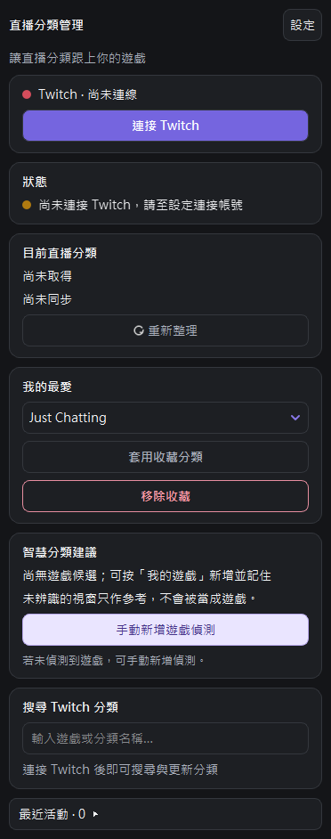

# Twitch 分類助手

在 OBS 裡搜尋、切換 Twitch 直播分類，讓分類跟上你正在玩的遊戲。

## 關於

- 搜尋 Twitch 分類，或從「我的最愛」快速套用常用分類。
- 記住遊戲與分類的對應，下次開啟遊戲時主動詢問是否切換；也能自行開啟自動更新。
- 遊戲結束後，詢問是否切換為 Just Chatting，等待時間可自行調整。
- 支援淺色／深色外觀、字型與文字大小設定。
- 遊戲辨識主要在電腦上處理，沒有遙測或自建雲端後端。登入、搜尋和修改分類會連線 Twitch。

## 安裝

[**下載 Windows 安裝檔（.msi，v0.5.4）**](https://github.com/Chizakuraowob/obs-twitch-auto-category/releases/download/v0.5.4/twitch-category-assistant-0.5.4-windows-x64.msi) · [所有版本與更新說明](https://github.com/Chizakuraowob/obs-twitch-auto-category/releases)

目前支援 **Windows 11 64 位元與 OBS Studio 32.2.2 64 位元官方安裝版**。MSI 會檢查 OBS 版本；其他版本與 OBS 可攜版尚不適用這個安裝方式。

> **Windows 安全性限制：目前發布檔尚未數位簽章。** 智慧型應用程式控制（Smart App Control）可能封鎖外掛，造成 MSI 安裝成功但 OBS 無法載入。遇到這種情況請停止安裝／使用並回報；目前沒有已簽章的替代版本。安裝器不會關閉防護或安裝信任憑證。

### 第一次安裝 Twitch 分類助手

1. 確認已安裝上述版本的 OBS。可以在 OBS 的「說明 → 關於」查看版本。
2. 結束直播與錄影，然後**完全關閉 OBS**。
3. 點上方「下載 Windows 安裝檔」並儲存檔案。安裝只需要這一個 `.msi`，不用另行下載原始碼或其他附件。
4. 雙擊下載的 MSI，閱讀授權說明，依畫面同意並按「安裝」。若 Windows 要求管理員權限，請先核對檔案來自本專案，再決定是否允許。
5. 若安裝器提示 OBS 正在執行，請關閉 OBS 後按「重試」。若不方便停止直播，可取消安裝，稍後再裝；安裝器不會替你強制關閉 OBS。
6. 安裝完成後，可勾選「完成後啟動 OBS Studio」，或自行開啟 OBS。第一次啟動會顯示「Twitch 分類助手」面板與設定精靈。
7. 依精靈閱讀條款、連接 Twitch 並選擇偏好。完成登入授權後，等待面板顯示已連線，再繼續下一步。

不需要另外安裝開發工具，也不需要申請 Twitch 開發者帳號。安裝位置由安裝器設定，不用手動複製 DLL。

### 安裝新版

結束直播／錄影並關閉 OBS，直接執行新版 MSI，**不需要先解除安裝舊版**。收藏、我的遊戲與偏好會保留；重新開啟 OBS 後即可使用。條款或隱私政策更新時只會請你重新確認，不會重跑整個設定精靈。

如果之前是自行複製檔案安裝，請先備份並移走舊的外掛資料夾，避免同一外掛重複載入。進階安裝與自行編譯請見 [開發指南](docs/development.md)。

### 移除

關閉 OBS，在 Windows「設定 → 應用程式 → 已安裝的應用程式」找到 **Twitch Category Assistant**，選擇解除安裝。個人設定會保留，方便日後重新安裝。

若也想移除帳號連線與資料，請在解除安裝前，先到外掛設定中登出、清除本機資料。既有備份、匯出檔與下載的安裝包需自行刪除；完整說明見 [隱私權政策](docs/privacy.md)。

## 使用說明

### 連接 Twitch

按「連接 Twitch」，在開啟的 Twitch 官方網頁登入並授權；若網頁要求驗證碼，輸入面板顯示的代碼。外掛不會向你索取 Twitch 密碼。

授權成功後，外掛會顯示勾選動畫與已連接的帳號，按「繼續，回到 OBS」才會關閉登入視窗。若視窗沒有切換，請自行點擊工作列的 OBS；Twitch 完成頁可以關閉。登出後，設定頁也會顯示完成提示。

登入後，面板只顯示目前帳號名稱；若要更換帳號，請到「設定 → Twitch 帳號」。設定頁上方可快速前往各區域。帳號旁的指示燈會顯示連線狀態，面板上方的狀態區則以綠色表示成功、黃色表示處理中或需注意、紅色表示錯誤，並附文字說明。

一般操作提示約 8 秒後會回到目前連線／偵測狀態；仍在進行的操作或持續異常會保留對應狀態。目前 Twitch 分類會在連線期間約每 30 秒自動同步，也可手動重新整理。

### 手動切換與我的最愛

手動搜尋位於「智慧分類建議」下方。輸入遊戲或分類名稱後會自動搜尋，也可以按 Enter 立即查詢，不需要再按搜尋按鈕；空白輸入不會送出搜尋。選取結果後按「套用選取分類」。常用分類可按「加入我的最愛」，之後直接從收藏選擇與套用。不必開始直播也能手動修改 Twitch 分類。

加入或移除收藏會在儲存成功後轉兩圈，顯示「收藏加入成功」或「已移除」；關閉動畫時直接顯示完成文字。

### 讓外掛記住遊戲

1. 開啟遊戲，到「設定 → 我的遊戲」按「新增遊戲」。
2. 選取遊戲視窗，再搜尋並選擇對應的 Twitch 分類，儲存即可。
3. 下次偵測到該遊戲且分類不同時，外掛會提出切換建議。辨識不確定時先由你確認，不會直接猜測分類。

「我的遊戲」一開始沒有資料是正常的。也可在設定精靈或設定頁開啟「向 Twitch 查詢遊戲名稱（聯網）」，讓外掛嘗試向 Twitch 尋找分類；預設關閉，找不到或名稱不明確時，仍需要你確認一次。若一般程式被誤認為遊戲，可在「我的遊戲」標記「不是遊戲」。

若未偵測到遊戲，可按面板上的「手動新增遊戲偵測」，選取遊戲視窗並記住對應分類。

預設在 OBS 直播期間才提出遊戲建議，且每次先詢問。可在設定調整偵測時機、通知方式或開啟自動更新。「本次遊戲不再提醒」只略過選取的建議，不更改 Twitch 分類。自動更新模式下，手動切換分類會暫停自動切換；面板會說明原因，按「恢復自動切換分類」才繼續。

### 遊戲結束後切換 Just Chatting

偵測到遊戲結束後，外掛會先等待一段時間，避免你只是正在換遊戲。等待時間可在設定或設定精靈中調整，範圍 **15～600 秒，預設 90 秒**；也可以關閉這項提醒。

提醒只有兩個選項：

- **切換為 Just Chatting**：確認後才修改 Twitch 分類。
- **這次不再提醒**：維持目前分類，本次遊戲結束不再詢問。關閉提醒視窗也有相同效果。

忽略後不會每隔一段時間再次跳出；下一次偵測到遊戲並結束後，才會重新詢問。若遊戲仍留在背景執行，提醒可能不會出現。

### 設定與更新

面板右上方「設定」可以調整外觀、字型、文字大小與通知，也能重新開啟設定精靈。

設定精靈的「通知偏好」與設定頁都能勾選「靜音模式」。開啟後，遊戲分類與 Just Chatting 提醒仍會顯示，但不發提示聲，也不搶走焦點；OBS 工作列圖示會閃爍。

在「設定 → 版本與更新」檢查新版。「下載、驗證並安裝更新」會核對檔案後，關閉 OBS 並開啟安裝精靈。請先儲存工作，停止直播、錄影、重播緩衝與虛擬攝影機；輸出進行中不會關閉 OBS。完成精靈後重新開啟 OBS。安裝成功會刪除此次下載的 MSI；取消或失敗則保留 MSI 與安裝記錄供重試。Windows 權限與安全提示仍需自行確認。舊版若只有下載功能，請下載後手動關閉 OBS、執行 MSI。

## 常見問題

**找不到外掛面板？**

在 OBS「停駐視窗」選單勾選「Twitch 分類助手」。若選單也沒有，請確認 MSI 安裝成功，以及 Windows 是否封鎖了外掛。

**遊戲已開啟，為什麼沒有提醒？**

確認「我的遊戲」已記住這款遊戲、分類建議未暫停，且目前 Twitch 分類與遊戲不同。若設定為只在直播時偵測，須先開始直播。新遊戲或特殊啟動方式可能需要先手動選擇遊戲視窗。

**登入網頁沒有開啟，或授權後仍未連線？**

確認網路可連上 Twitch，重新開啟 OBS 後再試一次。授權必須在 Twitch 網頁完成，且外掛顯示已連線才算成功。若持續失敗，請回報面板中的完整錯誤訊息，不要提供密碼或授權代碼。

**分類更新後沒有立刻顯示成功？**

外掛會向 Twitch 確認更新結果。請稍候或按「重新整理」，避免連續重複操作；若顯示操作過於頻繁，依提示稍後重試。

## 貢獻者與授權

維護者：**Chizakura**（GitHub：Chizakuraowob）；聯絡信箱：**admin@chizakura.dev**。

歡迎透過 [Issues](https://github.com/Chizakuraowob/obs-twitch-auto-category/issues) 回報問題或提出建議。請附 Windows、OBS 與外掛版本、重現步驟及錯誤訊息，截圖先遮蔽私人資料。

感謝 [OBS Project](https://obsproject.com/) 與 [obs-plugintemplate](https://github.com/obsproject/obs-plugintemplate)。GitHub 貢獻紀錄包含沿用的模板作者，不代表他們都參與此外掛的開發。本專案非 Twitch 或 OBS 官方產品。

© 2026 Chizakura 與貢獻者，採 [GPL-2.0-or-later](LICENSE)。

[使用者條款](docs/terms.md) · [隱私權政策](docs/privacy.md) · [資料處理說明](docs/data-processing.md) · [第三方授權](docs/third-party.md) · [原始碼提供](docs/source-distribution.md) · [開發指南](docs/development.md)
